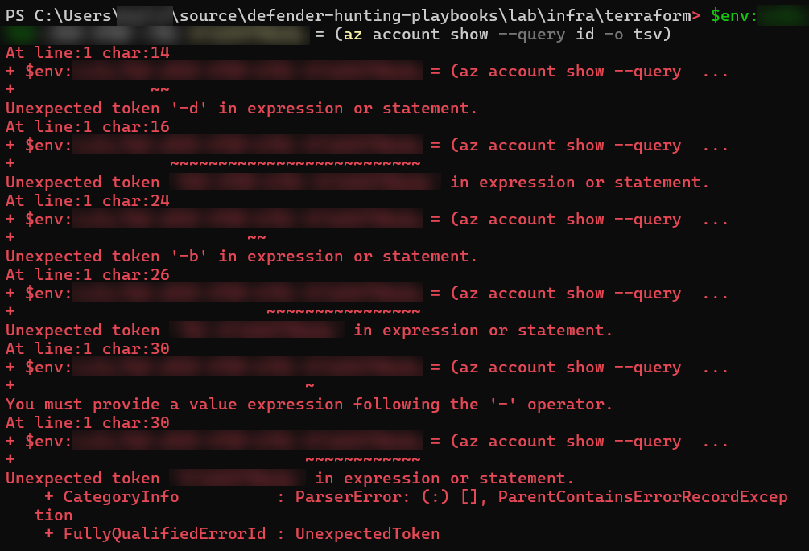
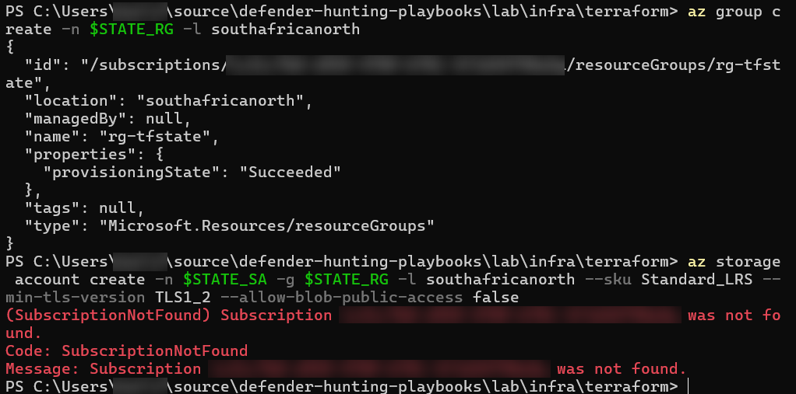

# Troubleshooting log

Real errors I hit while building this lab, what caused them, and how I fixed them. Screenshots are in [`lab/evidence/troubleshooting/`](../evidence/troubleshooting/), with subscription IDs and my username blurred.

| # | Step | Error | Root cause | Fix |
|---|---|---|---|---|
| 1 | Tool check | `can't open file '...\version'` | Typo: `python version` instead of `python --version` | Used the correct flag |
| 2 | Azure sign-in | `Unexpected token '-d' in expression or statement` | Replaced the variable **name** with the subscription ID | Typed the command exactly as written |
| 3 | State storage | `(SubscriptionNotFound) Subscription ... was not found` | The `Microsoft.Storage` resource provider wasn't registered on my new subscription | Registered the resource providers the lab needs |

---

## 1. Python "can't open file" (tool check)

**What happened:** I ran `python version` to check the installed version. Python treated `version` as the name of a script to run and failed with `can't open file 'C:\Users\...\version': [Errno 2] No such file or directory`.

**Fix:** `python --version`. Command-line options start with `--`; a bare word is read as a file name.

**Lesson:** read the error literally. "Can't open file" meant Python thought I'd given it a file.

## 2. PowerShell "Unexpected token" when setting the subscription (step 4)



**What happened:** the step was:

```powershell
$env:ARM_SUBSCRIPTION_ID = (az account show --query id -o tsv)
```

I thought `ARM_SUBSCRIPTION_ID` was a placeholder and replaced it with my real subscription ID. A subscription ID contains hyphens, and PowerShell read each `-d`, `-b` and so on as the start of an operator, so it failed with a series of `Unexpected token` errors.

**Root cause:** `ARM_SUBSCRIPTION_ID` is the **name** of an environment variable that the Terraform azurerm provider looks for. The part after `=` fetches the ID from Azure and stores it in that variable automatically.

**Fix:** ran the command exactly as written, then confirmed it without printing the ID:

```powershell
if ($env:ARM_SUBSCRIPTION_ID) { "Subscription is set" } else { "Not set" }
```

**Lessons:**
- Know the difference between a variable's name and its value.
- Keep IDs out of code and screenshots: let a command fetch them into an environment variable instead of typing them.

## 3. SubscriptionNotFound when creating the storage account (step 5)



**What happened:** `az group create` succeeded, but the next command, `az storage account create`, failed with `(SubscriptionNotFound) Subscription ... was not found` for the same subscription.

**Root cause:** the subscription existed (the resource group had just been created in it). On a new subscription, Azure services must be **registered** before first use; Azure calls them *resource providers*. Resource groups work without registration, but `Microsoft.Storage` wasn't registered yet, and on a new subscription that shows up as this misleading error.

**Fix:** registered the providers this lab needs (Storage for Terraform state; Log Analytics and Sentinel for the lab itself), waited until Storage showed `Registered`, then reran the command, which succeeded:

```powershell
az provider register --namespace Microsoft.Storage
az provider register --namespace Microsoft.OperationalInsights
az provider register --namespace Microsoft.OperationsManagement
az provider register --namespace Microsoft.SecurityInsights
az provider show -n Microsoft.Storage --query registrationState -o tsv   # repeat until "Registered"
```

**Lessons:**
- An error message can point the wrong way. "Subscription not found" was really "service not enabled on this subscription".
- Registering resource providers is a standard first step on any new Azure subscription. Registering the Sentinel providers now also heads off the same error at `terraform apply`.
